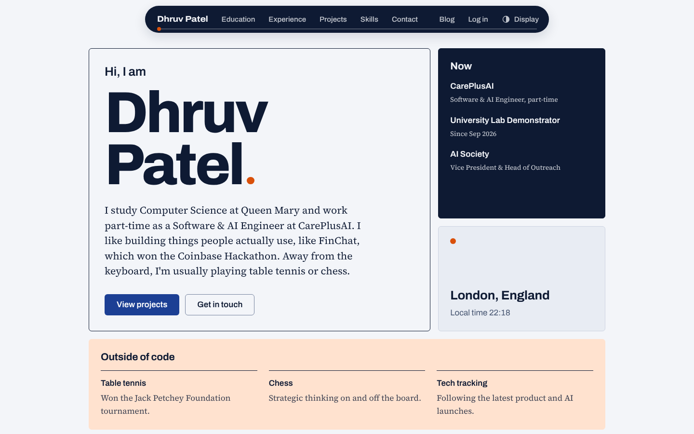
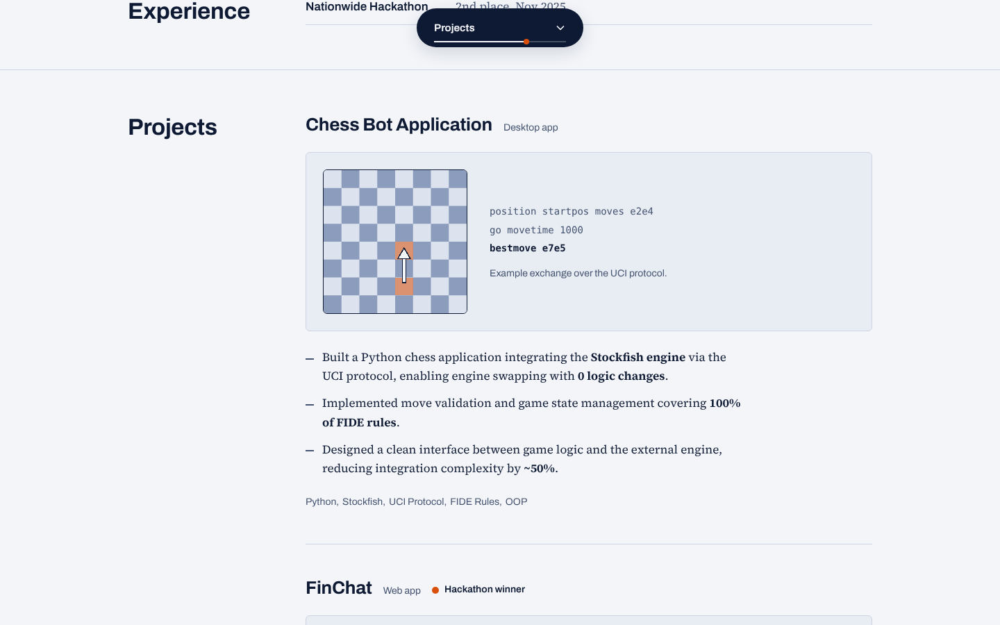

# Personal Portfolio & Blog

A personal portfolio website with an integrated blog system, built as coursework for ECS417U (Web Technologies) and doubling as my personal portfolio site.




## About

The portfolio is a single scrolling page (Education, Experience, Projects, Skills, Contact), opening with a bento grid with a separate blog behind it. The blog has role-based access control, comments and an admin post editor, all built from scratch in PHP without a framework.

## Tech Stack

- **Frontend:** HTML5, CSS3, vanilla JavaScript (all in external files, no inline scripts or styles)
- **Fonts:** Archivo and Source Serif 4, self-hosted in `fonts/` (SIL Open Font License, licences included)
- **Backend:** PHP (procedural, session-based auth)
- **Database:** MySQL (via MySQLi)
- **Environment:** XAMPP (Apache + MySQL)

## Features

- **One-page portfolio** that opens with a bento grid (a short personal statement under the name, current roles, London time, and a pastel "Outside of code" cell), then scrolls through the sections with smooth scrolling
- **Dynamic-island navigation**: a floating pill that is wide at the top of the page, shrinks to the current section's name while you read, and reopens on hover, keyboard focus or tap. It highlights the section you are in and carries a scroll-progress line with an orange ball. On phones it is a small pill that opens a menu; without JavaScript it becomes an ordinary header
- **Display menu** with Light, Dark and System themes plus a High contrast mode (7:1 text contrast, thicker borders). The choice is saved in the browser, and the OS preferences for colour scheme, contrast and reduced motion are respected
- **Blog system** with role-based access control:
  - Visitors can read all posts
  - Logged-in users (`user` or `admin` role) can comment
  - Only admins can create posts and delete posts and comments
- **Custom-sorted post feed**: posts are sorted most-recent-first using a hand-implemented merge sort in PHP (not SQL `ORDER BY`) as part of the assessment criteria
- **Post preview system**: admins can preview a post before publishing
- **Session-based login/logout** with secure password hashing (`password_hash` / `password_verify`)
- **Accessible by default**: skip link, visible keyboard focus, labelled form fields, reduced-motion support, and an axe-core audit with no violations in all four colour modes
- **Shared includes**: `head.php` (meta tags, Open Graph, icons, fonts, styles), `nav_header.php` and `footer.php` are used by every page
- Old page URLs (`education.php`, `portfolio.php`, `projects.php`, `skills.php`) redirect to the matching section of the home page

## Project Structure

```
├── index.php              # The whole portfolio, one scrolling page
├── viewBlog.php           # Blog feed (merge sort, comments, RBAC)
├── addEntry.php           # Admin: write a new blog post
├── previewPost.php        # Admin: preview post before publishing
├── addPost.php            # Admin: saves the post to the database
├── login.php / loginProcess.php / logout.php   # Auth
├── head.php               # Shared <head>: meta, Open Graph, icons, styles
├── nav_header.php         # Shared skip link and floating navigation pill
├── footer.php             # Shared footer and site script
├── db_connect.php         # MySQLi database connection
├── education.php, portfolio.php, projects.php, skills.php   # Redirects to home page sections
├── css/
│   ├── tokens.css         # Colours (4 themes), type scale, spacing, radius
│   ├── base.css           # Reset, typography, buttons
│   ├── layout.css         # Navigation pill, Display menu, footer
│   ├── portfolio.css      # Home page sections
│   ├── blog.css           # Blog feed, comments, preview
│   └── forms.css          # Login, create post, comment fields
├── js/
│   ├── theme.js           # Applies saved theme before first paint (loaded in <head>)
│   ├── site.js            # Navigation pill, Display menu, scroll progress, reveals, form loading state
│   └── addEntry.js        # Create-post form: clear confirm and blank-field validation
├── fonts/                 # Self-hosted variable fonts and licences
└── images/                # Icons, social preview card, screenshots
```

## Design system

Everything reads from `css/tokens.css`: a 4px spacing scale, one border radius, one type scale and four colour themes. To change the look of the whole site, change the tokens, not the components.

## Running Locally

This project requires a local PHP + MySQL environment (e.g. [XAMPP](https://www.apachefriends.org/)).

1. Clone the repo into your `htdocs` folder:
   ```bash
   git clone https://github.com/27DhruvP/personal_website.git
   ```
2. Start Apache and MySQL in the XAMPP control panel.
3. Create a database and the tables `users` (`id`, `email`, `password_hash`, `role`), `blog_posts` (`id`, `title`, `body`, `created_at`) and `comments` (`id`, `post_id`, `author`, `body`, `created_at`).
4. Edit `db_connect.php` with your own database host, name, user and password. Do not commit real credentials to a public repository.
5. Visit `http://localhost/personal_website/` in your browser.

## Author

**Dhruv Patel**
